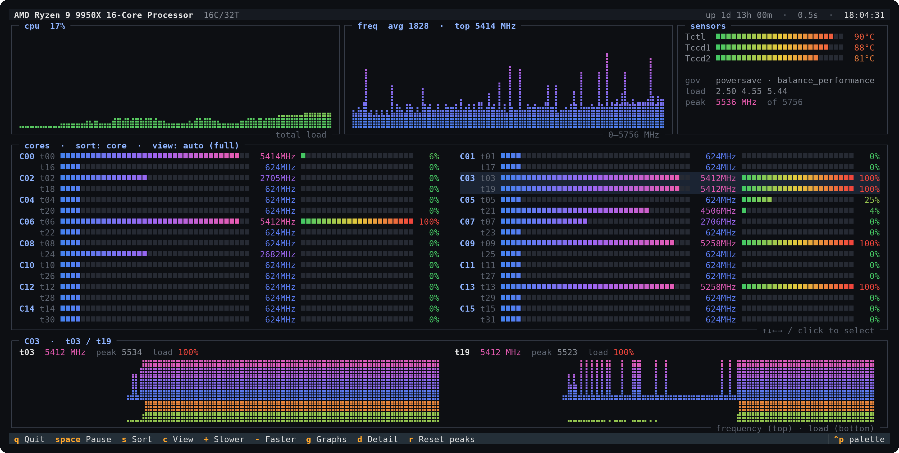

# cpuview

A btop-style terminal monitor that shows **every core's clock speed and load at once**, grouped by physical core, with temperature sensors and history graphs.



btop has the look but only shows one overall clock speed; CoreFreq has per-core data but a dense BIOS-style screen. cpuview sits in between.

## Features

- **Per-thread clock speed and load bars**, two rows per physical core (e.g. t03 and its SMT sibling t19), so you can watch boost behavior thread by thread
- **Auto-fitting layout**: picks 1–4 columns and a full or compact view so all cores fit on screen without scrolling. Compact view packs each core into one line using split bars (upper half = first thread, lower half = second)
- **History graphs** (braille, btop-style) for total load and average clock speed
- **Detail panel** with clock-speed and load history for each thread of the selected core
- **Sensors**: CPU temperatures (`k10temp` / `zenpower` / `coretemp`), cpufreq governor and EPP, load average, peak clock seen
- Sort cores by number, load or frequency; adjustable update interval; mouse support
- No root needed — reads `/proc/stat` and sysfs only

## Install

Requires Python 3.9+ on Linux.

```sh
git clone https://github.com/SuperComboGamer/cpuview.git
cd cpuview
./install.sh
cpuview
```

`install.sh` creates a private virtualenv in `~/.local/share/cpuview/venv` with [Textual](https://github.com/Textualize/textual) and puts a `cpuview` launcher in `~/.local/bin`. Nothing is installed into the system Python.

## Keys

| Key | Action |
|---|---|
| `↑↓←→` / `hjkl` / click | select a core |
| `s` | sort cores: number → load → frequency |
| `c` | view: auto → full → compact |
| `+` / `-` | update interval (0.25 / 0.5 / 1 / 2 / 5 s) |
| `space` | pause |
| `g` | show / hide history graphs |
| `d` / `enter` | show / hide detail panel |
| `r` | reset peak clocks |
| `q` | quit |

## Notes

- Clock speeds come from the kernel's cpufreq reporting (`scaling_cur_freq`), which is slightly less precise than tools that read hardware counters directly (like CoreFreq), but close enough to watch boost behavior.
- Ryzen reports temperature per CCD (`Tctl`, `Tccd1`, `Tccd2`), not per core, so temperatures are shown in the sensors panel rather than on each core.
- The graphs use braille characters; any modern terminal font supports them.

## Uninstall

```sh
rm -r ~/.local/bin/cpuview ~/.local/share/cpuview
```
